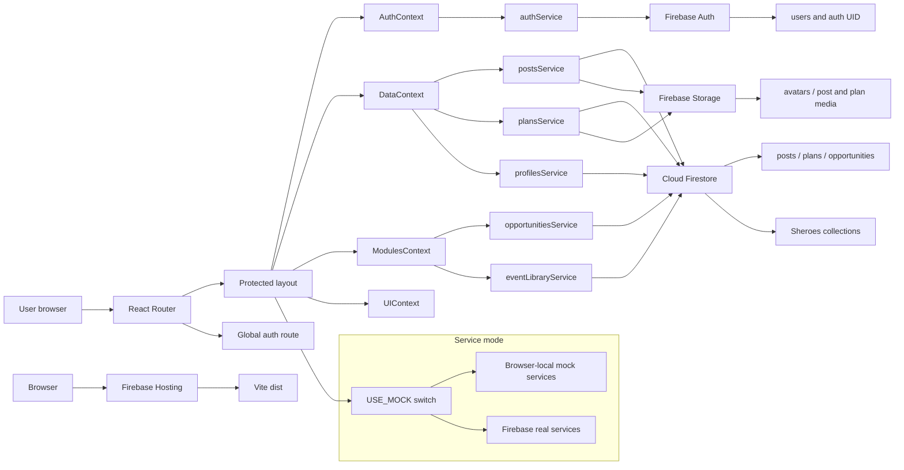

# MaSphere

MaSphere is an employee social and collaboration web application for Mastek colleagues. It combines a social feed, community plans, opportunity discovery, event calendar, VECTOR rewards, profile management, admin workflows, and the women-only Sheroes community.

- Live website: https://masphere-4a6ff.web.app
- Firebase project: `masphere-4a6ff`
- Android handoff: [SHEROES_MOBILE_README.md](./SHEROES_MOBILE_README.md)

## Table of contents

- [Product features](#product-features)
- [Application routes](#application-routes)
- [Technology stack](#technology-stack)
- [System design architecture](#system-design-architecture)
- [Data and service architecture](#data-and-service-architecture)
- [Firestore collections](#firestore-collections)
- [Security model](#security-model)
- [Firebase setup](#firebase-setup)
- [Local development](#local-development)
- [Build and deployment](#build-and-deployment)
- [Responsive and accessible UI](#responsive-and-accessible-ui)
- [Testing and verification](#testing-and-verification)
- [Known limitations and follow-ups](#known-limitations-and-follow-ups)

## Product features

| Area | Features |
| --- | --- |
| Authentication | Email/password signup and login, Mastek email validation, profile loading, password change, account deletion, protected routes |
| Discover feed | Instagram-style post feed, feed filters, post creation, image/media posts, likes, comments, bookmarks, category tags, VECTOR tags |
| Plans | Create plans, set location/date/budget/category, request to join, host approvals, decline/accept requests, private group rooms |
| Group collaboration | Group chat, time polls, meeting-point pin, event rating and completion, Explorer badge points |
| Opportunities | Browse and filter hackathons, conferences and workshops, team size, skills, internal/external scope, registration deadline |
| Mastek Calendar | Month and agenda views, office/category filters, event detail, save event, add to personal calendar, registration flow, admin publishing |
| VECTOR Rewards | Points overview, six value categories, score history, earned/locked badges, leaderboards and office/team/value filters |
| Profile | Avatar upload/removal, personal details and gender, interests, bio, stats, VECTOR scores, badges, posts, plans, bookmarks and personal calendar |
| Settings | Account, profile, privacy, notifications, appearance, interests and data/security settings |
| Admin Console | Event management, publishing workflow, organiser assignments, VECTOR rules and audit history; protected by the profile `admin` field |
| Sheroes | Profile-gated women community, text/image posts, likes, comments, unrestricted activity challenges, join, progress and leaderboard |
| Themes | Light and dark themes, pink Sheroes theme, responsive desktop/tablet/mobile layouts |

## Application routes

| Route | Screen |
| --- | --- |
| `/login` | Authentication |
| `/discover` | Discover social feed |
| `/sheroes` | Women-only Sheroes community |
| `/plans/:id?` | Plan discovery or approved group room |
| `/opportunities` | Opportunities and team matching |
| `/calendar` | Mastek event calendar |
| `/rewards` | VECTOR rewards and leaderboards |
| `/profile` | Logged-in member profile |
| `/settings/:tab?` | Account and preference settings |
| `/admin` | Admin console for authorised profiles |

Unknown routes are redirected to `/discover`.

## Technology stack

### Frontend

- React 18
- React Router 6
- Vite 5
- Vanilla CSS design system and CSS variables
- Browser APIs for notifications and media selection
- Firebase Web SDK 12

No UI framework or state-management library is required. React context is used for authentication, UI/theme state, general social data, and module/event data.

### Backend and platform

- Firebase Authentication
- Cloud Firestore
- Firebase Storage
- Firebase Hosting
- Firebase Security Rules
- Google Chrome/modern browser Notifications API

### Development and deployment

- npm
- Firebase CLI
- Git/GitHub
- Vite production bundler

## System design architecture



### Request flow

1. The browser loads the Vite-built React application from Firebase Hosting.
2. `AuthProvider` restores or subscribes to the Firebase Auth session.
3. Protected layout components provide user, social, module, and theme contexts.
4. Real mode uses Firebase Auth and Firestore listeners; mock mode uses seeded in-browser services.
5. Writes use input validation and, where required, Firestore transactions.
6. Firebase Security Rules enforce authentication and document ownership server-side.
7. Storage media is uploaded to scoped paths and referenced from its Firestore document.

## Data and service architecture

The frontend separates presentation from data access.

- `src/pages/` contains route-level screens.
- `src/components/` contains reusable layout, post, plan, input, and status components.
- `src/context/` owns cross-page application state.
- `src/services/` contains mock and real Firebase implementations.
- `src/data/` contains demo constants and seed data.
- `src/styles/global.css` contains design tokens and screen-level presentation rules.

Every major service supports mock and real implementations behind `VITE_USE_MOCK`.

| Concern | Implementation |
| --- | --- |
| Authentication and profile | `authService.js`, `firebaseModels.js` |
| Posts, likes, saves and comments | `postsService.js` |
| Plans and group rooms | `plansService.js` |
| Member profiles | `profilesService.js` |
| Opportunities | `opportunitiesService.js` |
| Event bookmarks and personal calendar | `eventLibraryService.js` |
| Sheroes | `sheroesService.js` |
| Media | `profileMediaService.js`, Firebase Storage |
| Theme and modal state | `UIContext.jsx` |
| Realtime lists | Firestore `onSnapshot` listeners |
| Atomic updates | Firestore transactions |

## Firestore collections

| Collection/path | Purpose |
| --- | --- |
| `users/{uid}` | Profile and preferences |
| `users/{uid}/savedEvents/{eventId}` | Private saved events |
| `users/{uid}/calendarEvents/{eventId}` | Personal calendar entries |
| `posts/{postId}` | Main community posts |
| `plans/{planId}` | Community plans and join state |
| `plans/{planId}/joinRequests/{uid}` | Join requests |
| `plans/{planId}/messages/{messageId}` | Approved plan group chat |
| `opportunities/{opportunityId}` | Hackathons, conferences and workshops |
| `sheroesMembers/{uid}` | Self-attested Sheroes membership |
| `sheroesPosts/{postId}` | Sheroes feed posts |
| `sheroesChallenges/{challengeId}` | Sheroes open challenges |
| `sheroesChallenges/{challengeId}/participants/{uid}` | Challenge participation and progress |

Representative service contracts and mobile field names are documented in [SHEROES_MOBILE_README.md](./SHEROES_MOBILE_README.md).

## Security model

### Authentication

- Firebase Authentication owns credentials.
- New signup email addresses must use `@mastek.com`.
- Signup requires a matching `users/{uid}` profile document.
- Browser clients cannot create or modify the protected `admin` profile field.
- Protected application routes require an authenticated profile.
- Sheroes routes additionally verify that the profile Gender is `Woman` or `Female`.

### Authorization

Firestore rules enforce server-side access:

- Profile reads are authenticated.
- Users may create, update and delete only their own profile.
- User creation cannot set `admin`.
- Profile updates preserve UID, email and admin status.
- Main posts, plans and opportunities require a signed-in user.
- Post comments and likes use controlled field updates.
- Plan messages are readable only by the host or approved plan members.
- Join requests are limited to their requester or plan host.
- Sheroes reads require a verified Sheroes membership document for the authenticated UID.
- Only a Sheroes member may create Sheroes posts, challenges or participation records.
- Post and challenge updates are limited to the operations declared in the rules.
- Participants may update only their own progress.

### Storage

- General post media: `posts/{postId}/{fileName}`, maximum 50 MB.
- Plan media: `plans/{planId}/{fileName}`, maximum 10 MB.
- User avatars: `users/{uid}/avatar/{fileName}`, owner-only write, maximum 10 MB.
- Sheroes images: `sheroes-posts/{uid}/{postId}/{fileName}`, member reads and owner-only writes, maximum 10 MB.

The Storage rules reject non-image media in image-only paths and prevent users from writing another user's avatar or Sheroes image path.

### Secrets and client security

- Firebase Web configuration is client-visible and must not be mistaken for a server secret.
- `.env` is excluded from Git.
- Never place a Firebase Admin SDK service-account key in the web app or APK.
- Authorised Firebase project administration should use a trusted server or Firebase Console.
- HTTPS is used for the deployed website.
- The app validates UI inputs, but security decisions must remain in Firebase Authentication and security rules.

### Privacy considerations

- Gender is a profile field used for women-only Sheroes access.
- Membership is self-attested and should not be described as identity verification.
- Sheroes membership is stored separately from general public profile sharing.
- Sheroes progress is currently self-reported, not imported from a health provider.
- Location and profile visibility options are stored in profile settings and are presentation/privacy preferences; sensitive policy requirements should be mirrored in Security Rules before production rollout.

## Firebase setup

1. Create or select the `masphere-4a6ff` Firebase project.
2. Register a Web App and copy its configuration.
3. Enable Firebase Authentication with Email/Password.
4. Create a Firestore database.
5. Create the Storage bucket.
6. Copy `.env.example` to `.env`.
7. Set `VITE_USE_MOCK=false`.
8. Fill all required Firebase Web environment variables.

```dotenv
VITE_USE_MOCK=false
VITE_FIREBASE_API_KEY=your_web_api_key
VITE_FIREBASE_AUTH_DOMAIN=masphere-4a6ff.firebaseapp.com
VITE_FIREBASE_PROJECT_ID=masphere-4a6ff
VITE_FIREBASE_STORAGE_BUCKET=masphere-4a6ff.appspot.com
VITE_FIREBASE_MESSAGING_SENDER_ID=your_sender_id
VITE_FIREBASE_APP_ID=your_app_id
```

Restart Vite after changing `.env`.

Existing Firebase accounts require a matching `users/{uid}` document. Granting `admin: true` must be done in a trusted environment, not by editing the browser form or signup payload.

## Local development

### Requirements

- Node.js 18 or later
- npm
- Optional: Firebase CLI for rules and Hosting deployment

### Start in demo mode

```sh
npm install
npm run dev
```

Demo mode is enabled unless `VITE_USE_MOCK=false`.

Demo accounts:

| Role | Email | Password |
| --- | --- | --- |
| Employee | `ananya.rao@mastek.com` | `demo1234` |
| Admin | `meera.pillai@mastek.com` | `admin1234` |

### Start in Firebase mode

```sh
cp .env.example .env
# Fill the Firebase values and set VITE_USE_MOCK=false
npm install
npm run dev
```

Open the local URL reported by Vite, normally `http://localhost:5173`.

## Build and deployment

### Production build

```sh
npm run build
npm run preview
```

The production output is written to `dist/`.

### Deploy Firestore and Storage rules

```sh
npx firebase-tools login
npx firebase-tools deploy --only "firestore,storage" --project masphere-4a6ff
```

### Deploy Hosting

```sh
npm run build
npx firebase-tools deploy --only hosting --project masphere-4a6ff
```

The live website is https://masphere-4a6ff.web.app.

`firebase.json` configures `dist` as the public directory and rewrites all paths to `index.html`, so React Router routes work on Hosting refreshes.

## Responsive and accessible UI

- Desktop: fixed left sidebar, top search/navigation bar, center content and optional right rail
- Tablet: right Discover rail collapses
- Mobile: sidebar is replaced by a fixed bottom navigation bar
- Cards use 16 px radii, hairline borders and restrained shadows
- Light and dark themes use shared CSS variables
- Sheroes has a scoped pink/rose theme
- Instagram-inspired interactions include compact cards, rounded controls, tactile hover/press states, avatar stacks and presence dots
- Motion lasts 150–250 ms and is disabled when `prefers-reduced-motion` is enabled
- Icon controls require visible labels or accessible names
- Loading skeletons, empty states and inline errors are used for asynchronous areas
- Keyboard focus uses visible focus rings

## Testing and verification

Before each release:

1. Run `npm run build`.
2. Verify `/login`, `/discover`, `/plans`, `/opportunities`, `/calendar`, `/rewards`, `/profile` and `/settings`.
3. Verify `/sheroes` with both Woman and non-Woman profiles.
4. Test signup, login, password change and account deletion.
5. Test post creation, image upload, like/comment and save operations.
6. Test plan creation, join request, approval, group chat and completion.
7. Test opportunity creation, interest requests and team acceptance.
8. Test desktop, tablet and mobile widths.
9. Test light and dark themes.
10. Test Firestore denied operations and Storage upload limits.
11. Deploy rules before authenticated end-to-end testing.

### Sheroes release checks

- A profile set to Woman can enter Sheroes.
- A Man or Prefer-not-to-say profile is redirected away.
- A new member is created automatically when entering Sheroes.
- Text-only posts, image posts and combined posts work.
- Images above 10 MB are rejected.
- Challenge activity is unrestricted and no fixed activity preset is assumed.
- Joining and progress updates preserve UID ownership.
- Firestore rejects posts or reads from unauthorised users.

## Known limitations and follow-ups

- Browser notifications require user permission and operate while MaSphere is open.
- Active-now, presence and activity counts are visual placeholders until a presence backend is implemented.
- Event seed/catalog behaviour may differ from a full event-management backend.
- Admin and audit functionality in mock/demo state is frontend-controlled; production authorization should be completed through trusted backend processes and rules.
- Sheroes membership is self-attested and is not independently verified.
- Sheroes challenge progress is user-entered and not automatically sourced from Health Connect or a fitness service.
- Profile image and social media image fields should be monitored for Storage size and abuse controls.
- Sensitive cross-user privacy settings should be mirrored in server rules before exposing private profile fields beyond authenticated employees.
- The Android APK source is not included in this repository.
